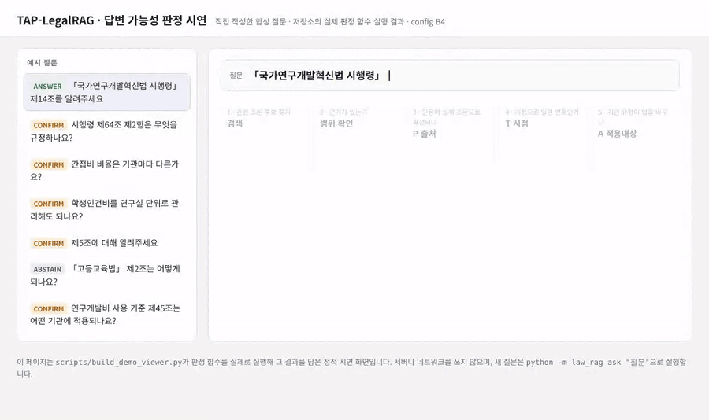
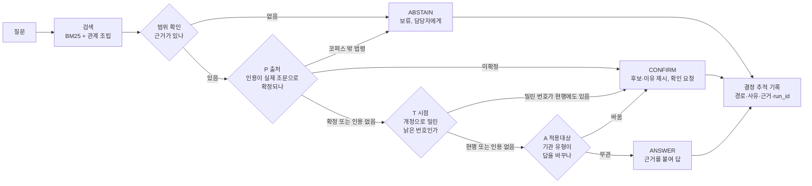

# TAP-LegalRAG

*Research Administration · Trustworthy AI · Legal RAG*

[](https://github.com/aiforbetterfuture/tap-legalrag/actions/workflows/tests.yml)
[](LICENSE)


**연구행정 규정 질문에 바로 답하지 않고, 먼저 "이 근거로 답해도 되는가"를 판정하는 연구용 프로토타입입니다.**
검색으로 찾은 조문을 그대로 답에 쓰기 전에 **출처(P)·시점(T)·적용대상(A)** 세 가지를 확인하고, 결과에 따라
**답변(ANSWER) · 확인 요청(CONFIRM) · 보류(ABSTAIN)** 중 하나를 고릅니다.

> **이 저장소는 운영 서비스나 법률 자문이 아닙니다.** 국가연구개발 규정 질의에서 "언제 자동으로 답해도 되고, 언제 담당자에게 넘겨야 하는가"를 설계하고 측정한 소규모 연구 프로토타입입니다. 한계는 [한계](#10-한계--이-결과를-어디까지-믿어도-되나)와 [LIMITATIONS](docs/LIMITATIONS.md)에 정리했습니다.



*직접 작성한 질문 7건을 저장소의 실제 판정 함수로 실행한 결과를 단계별로 보여 주는 시연 화면입니다([docs/demo/viewer.html](docs/demo/viewer.html)). 질문 → 검색 → 범위 확인 → 출처(P) → 시점(T) → 적용대상(A) → 결정 순서로 진행하고, 마지막에 결정 추적 기록을 보여 줍니다. 마지막 예시는 시스템이 틀리는 **알려진 결함 사례**입니다.*

---

## 3분 요약

| 질문 | 답 |
|---|---|
| **무슨 문제인가?** | 연구행정 문의에는 근거 조문을 붙여 답해야 합니다. 그런데 "제9조"처럼 법령 이름 없이 인용되거나, 개정으로 번호가 밀린 조문이거나, 기관 유형에 따라 답이 달라지는 경우가 많습니다. 이때 그럴듯하게 단정한 답이 가장 위험합니다. |
| **무엇을 만들었나?** | 검색 결과와 답변 사이에 **판정 게이트**를 하나의 부품으로 넣었습니다. 게이트는 규칙 기반이고 결정론적이라 같은 입력에는 항상 같은 판정과 같은 이유를 냅니다. |
| **무엇을 확인했나?** | 조문 인용 100건(사람 검수 포함)과 실무형 질문 91문항으로 실험했습니다. 게이트는 **답하면 안 되는 질문에 그냥 답한 경우를 14건 중 14건에서 7건으로** 줄였고, 그 대가로 답할 수 있는 질문 일부를 보류했습니다. |
| **가장 중요한 발견은?** | **"정답을 무엇으로 정하느냐"에 따라 방식 간 순위가 바뀌었습니다.** 그래서 한 가지 점수만 내세우지 않고 세 가지 기준과 오류 유형을 함께 보고합니다. |
| **무엇이 아직 아닌가?** | OCR·RPA·업무시스템 연계·권한관리·사용자 평가·제3자 독립 검수·LLM 종단 간 평가는 하지 않았습니다. [구현 범위](#7-구현-범위--무엇이-되고-무엇이-안-되나) 표에 구분해 두었습니다. |

### 이 저장소가 보여 주는 것

| 역량 | 이 저장소의 근거 | 위치 |
|---|---|---|
| 현장 문제 정의·업무 분석 | 연구행정 규정 질의의 실패 유형(출처·시점·적용대상)을 정의하고, 담당자 업무 흐름을 As-is/To-be로 정리(설계 가정) | [1절](#1-왜-만들었나--그럴듯한-오답이-가장-위험하다), [WORKFLOW](docs/WORKFLOW.md) |
| 프로토타입 설계·구현 | 검색 + P·T·A 판정 게이트, 단일 결정 경로, CLI, 에이전트용 MCP 도구 3개 | [2~4절](#2-왜-이-아키텍처인가--설계-결정-6가지) |
| 자동화 성능 평가 | 정확성과 오류 유형(오귀속·근거 없는 확정·잘못된 보류)을 함께 측정, 절제 실험, 사람 검수 100건 | [5절](#5-무엇을-확인했나--평가-결과) |
| 신뢰 가능한 자동화 | 확인 요청·보류로 사람에게 넘기는 경로, 결정 추적 기록, 에이전트 도구 최소 권한(읽기 전용·네트워크 없음), 개인정보·저작권 검사 | [6절](#6-보안데이터-보호-설계), [SECURITY](SECURITY.md) |
| 재현 가능한 개발 | 평가 동결, 문서 수치 자동 대조, 테스트와 CI(Ubuntu·Windows), 공개판 추출 검사 | [8절](#8-테스트와-재현), [TESTING](docs/TESTING.md) |
| 재사용 가능한 구성요소 | 게이트·평가 하니스·공개판 추출 파이프라인을 부품으로 분리하고, 설계 결정과 대가를 기록 | [DESIGN_DECISIONS](docs/DESIGN_DECISIONS.md) |

---

## 목차

1. [왜 만들었나](#1-왜-만들었나--그럴듯한-오답이-가장-위험하다)
2. [왜 이 아키텍처인가](#2-왜-이-아키텍처인가--설계-결정-6가지)
3. [구조 한눈에 보기](#3-구조-한눈에-보기)
4. [빠르게 실행해 보기](#4-빠르게-실행해-보기)
5. [무엇을 확인했나 (평가 결과)](#5-무엇을-확인했나--평가-결과)
6. [보안·데이터 보호 설계](#6-보안데이터-보호-설계)
7. [구현 범위](#7-구현-범위--무엇이-되고-무엇이-안-되나)
8. [테스트와 재현](#8-테스트와-재현)
9. [데이터와 라이선스](#9-데이터와-라이선스--세-층으로-나뉩니다)
10. [한계](#10-한계--이-결과를-어디까지-믿어도-되나)
11. [로드맵과 관련 프로젝트](#11-로드맵과-관련-프로젝트)
12. [문서 지도](#12-문서-지도)

---

## 1. 왜 만들었나 — "그럴듯한 오답"이 가장 위험하다

연구행정 담당자는 협약 변경, 연구개발비 정산, 연구장비 심의 같은 문의에 **근거 조문을 붙여** 답합니다. 검색 기반 AI(RAG)는 관련 조문을 빠르게 찾아 주지만, 찾은 조문으로 **답해도 되는지**는 별개의 문제입니다. 실제로 자주 생기는 함정은 세 가지입니다.

| 함정 | 예시 | 단정하면 생기는 일 |
|---|---|---|
| **출처가 불분명** | 문서에 "제9조"만 적혀 있다 | 혁신법인지 시행령인지 고시인지 모른 채 엉뚱한 법에 귀속(오귀속) |
| **시점이 어긋남** | 해설서의 "시행령 제64조 제2항"이 개정으로 번호가 밀렸는데, **현행에도 같은 번호가 존재** | 번호만 보고 답하면 옛 조문이든 새 조문이든 틀릴 수 있음 |
| **적용대상이 다름** | "간접비 비율은 기관마다 다른가요?" | 대학·출연연·영리기관 등 기관 유형에 따라 답이 갈림 |

> **비유:** 약사는 처방전을 받으면 바로 약을 내주지 않습니다. ① 처방전이 진짜 그 병원에서 나왔는지(출처), ② 유효기간이 지나지 않았는지(시점), ③ 이 환자에게 맞는 약인지(적용대상)를 먼저 확인합니다. 하나라도 걸리면 의사에게 다시 묻습니다(확인 요청). TAP는 연구행정 질의에서 이 약사의 역할을 맡습니다.

이 프로젝트의 가정은 단순합니다. **연구행정 자동화의 핵심은 답을 빨리 만드는 것보다, 자동으로 답해도 되는 순간과 사람에게 넘겨야 하는 순간을 정확히 가르는 것**입니다.

---

## 2. 왜 이 아키텍처인가 — 설계 결정 6가지

처음 코드를 읽는 분이 "왜 이렇게 만들었지?"라고 물을 만한 지점을 먼저 설명합니다. 각 결정의 배경·대안·대가는 [DESIGN_DECISIONS](docs/DESIGN_DECISIONS.md)에 더 자세히 적었습니다.

### ① 검색과 "답해도 되는가"를 서로 다른 부품으로 나눴습니다

검색기는 "관련 있어 보이는 조문"을 찾는 일에 최적화되어 있습니다. "이 조문으로 단정해도 안전한가"는 다른 질문입니다. 두 일을 한 덩어리로 만들면, 결과가 틀렸을 때 **검색이 못 찾아서인지, 찾았는데 판단을 잘못해서인지** 구분할 수 없습니다. 그래서 판정을 `gate.py`라는 독립 부품으로 분리했습니다. 덕분에 검색을 바꿔도 게이트는 그대로이고, 게이트의 효과만 따로 잴 수 있습니다.

### ② 확인 항목을 P·T·A 세 축으로 나눴습니다

세 축은 위 표의 세 가지 함정에 하나씩 대응합니다. 축을 나눠 두면 **한 축씩 끄고 다시 실행하는 절제 실험(ablation)** 이 가능합니다. 실제로 이 실험에서 효과가 주로 A(적용대상)에서 나오고, P·T는 이 데이터에서 아직 순이득이 아니라는 사실을 확인했습니다. 축을 합쳐 두었다면 이런 사실을 알 수 없었습니다.

### ③ 답을 "예/아니오" 두 가지가 아니라 세 가지로 냈습니다

"답한다 / 거부한다" 둘만 있으면, 애매한 경우 시스템은 둘 다 나쁜 선택지 중 하나를 골라야 합니다. 현업에서는 "후보가 두 개인데 어느 쪽인지 확인해 주세요"라는 **중간 답**이 가장 유용할 때가 많습니다. 그래서 `CONFIRM`(후보와 이유를 보여 주고 확인 요청)을 따로 두었습니다. 조문 번호가 밀린 경우에도 번호를 마음대로 고쳐 답하지 않고, 현행 위치와 종전 위치 **후보 두 개를 제시**하도록 했습니다.

### ④ 판정은 LLM이 아니라 규칙으로, 결정론적으로 했습니다

행정 판단은 나중에 "왜 그렇게 답했는가"를 설명할 수 있어야 합니다. 판정 단계에 생성형 모델을 쓰면 같은 질문에도 결과가 달라질 수 있고, 판정 이유를 재현하기 어렵습니다. 그래서 판정은 규칙 기반으로 만들고, 매 결정마다 **경로(P→T→A)·사유·근거·실행 ID를 남기는 결정 추적 기록**을 함께 반환합니다. 같은 설정으로 두 번 실행하면 결과 파일이 같습니다.

### ⑤ 평가하는 경로와 실제로 쓰는 경로를 하나로 묶었습니다

평가 스크립트, 시연, 명령줄 실행(CLI), MCP 도구가 모두 같은 함수 `law_rag.decide.decide_for_query`를 거칩니다. 평가용 코드와 실사용 코드가 다르면, 평가 점수가 실제 동작을 설명하지 못하기 때문입니다.

### ⑥ 무거운 의존성과 네트워크를 쓰지 않았습니다

임베딩 모델, 벡터DB, 외부 API 없이 `pydantic`과 `pytest`만으로 돌아갑니다. 이유는 두 가지입니다. 첫째, 누구나 같은 결과를 **재현**할 수 있어야 연구 결과를 검토할 수 있습니다. 둘째, 실행 중 외부로 데이터가 나가지 않으므로 **보안상 공격 표면이 작습니다**([6절](#6-보안데이터-보호-설계)). 대신 검색 성능이 낮다는 대가가 있으며, 이 수치도 그대로 보고합니다.

---

## 3. 구조 한눈에 보기



게이트는 **범위 → P → T → A 순서로 검사하고, 처음 걸리는 곳에서 멈춥니다.** P·T는 질문에 조문 인용이 있을 때만 작동합니다. 옛 번호가 현행에 더는 없을 때 현행 위치로 고쳐 주는 전제 교정(CORRECT) 같은 세부 분기는 [WORKFLOW](docs/WORKFLOW.md)의 상태 전이도에 모두 그렸습니다.

| 판정 축 | 무엇을 확인하나 | 걸리면 |
|---|---|---|
| **P 출처** (`provenance.py`) | 질문 속 인용이 코퍼스의 실제 조문으로 확정되는가. 상태: 확정 / 부분 / 모호 / 미확정 | 코퍼스 밖 법령이면 보류, 법령을 특정하지 못하면 확인 요청 |
| **T 시점** (`temporal.py`) | 인용된 번호가 개정 계보상 밀린 번호인가, 현행에도 같은 번호가 있는가 | 단정하지 않고 현행·종전 후보 두 개를 제시 |
| **A 적용대상** (`clarify.py`) | 기관 유형·준용 관계에 따라 답이 갈리는가 | 기관 유형을 묻거나(ASK) 유형별로 나눠 제시(BRANCH) |

게이트의 상태가 어떻게 넘어가는지는 [WORKFLOW](docs/WORKFLOW.md)의 상태 전이도에, 모듈별 역할은 [ARCHITECTURE](docs/ARCHITECTURE.md)에 있습니다.

---

## 4. 빠르게 실행해 보기

```bash
git clone https://github.com/aiforbetterfuture/tap-legalrag && cd tap-legalrag
python -m pip install -r requirements-lock.txt

# macOS / Linux
PYTHONPATH=src python -m law_rag ask "간접비 비율은 기관마다 다른가요?"

# Windows PowerShell
$env:PYTHONPATH="src"; $env:PYTHONUTF8="1"
python -m law_rag ask "간접비 비율은 기관마다 다른가요?"
```

명령줄에서 실행한 모습입니다(실제 CLI 출력을 녹화한 화면이며, `run_id`는 실행할 때마다 달라집니다).


실제 출력 예시:

```text
[CONFIRM] 시행령 제64조 제2항은 무엇을 규정하나요?
  사유: 인용 번호가 현행에도 있고 계보상 밀린 번호이기도 함 — 현행 64조제2항 / 종전 번호의 현행 위치 64조제3항
  질문 인용: 시행령 제64조 제2항 → P=RESOLVED, 법령 013933 제64조제2항
  경로: P=013933:64 → T=AMBIGUOUS_HISTORIC  config=B4 판본=CORPUS-20260802
```

아래 질문은 모두 이 저장소에서 **직접 작성한 합성 예시**입니다. 해설서 문장을 쓰지 않았고, 평가 수치와는 무관합니다([examples/synthetic](examples/synthetic/)).

| 질문 | 결정 | 왜 그렇게 판정했나 |
|---|---|---|
| 연구기관이 공동연구기관 변경을 요청했습니다. 「국가연구개발혁신법 시행령」 제14조에 따른 협약 변경 절차를 확인해 주세요 | ANSWER | 법령 이름이 인용에 있어 출처가 확정됨 |
| 작년 매뉴얼에 나온 시행령 제64조 제2항 기준으로 연구기관에 안내해도 될까요? | CONFIRM | 개정으로 밀린 번호이면서 현행에도 같은 번호가 있음 → 후보 2개 |
| 간접비 비율은 기관마다 다른가요? | CONFIRM | 기관 유형별로 답이 갈림(A: BRANCH) |
| 학생인건비를 연구실 단위로 관리해도 되나요? | CONFIRM | 판단 기준이 되는 상황(대상·단계)을 먼저 되물음(A: ASK) |
| 제5조에 대해 알려주세요 | CONFIRM | 법령 단서가 없어 출처를 확정할 수 없음 |
| 「고등교육법」 제2조는 어떻게 되나요? | ABSTAIN | 이 프로토타입이 다루지 않는 법령 → 보류 |
| 연구개발비 사용 기준 제45조는 어떤 기관에 적용되나요? | CONFIRM | **알려진 결함 사례.** 괄호 없는 고시 이름을 사전이 못 알아봐 출처 미확정으로 처리됨(v1.1 수정 대상) |

마지막 줄처럼 **시스템이 틀리는 예시도 일부러 남겼습니다.** 무엇이 안 되는지 보여 주는 것이 이 연구의 일부입니다.

**시연 화면 직접 열기.** 아래 명령은 위 예시를 실제 판정 함수로 다시 실행해 `docs/demo/viewer.html`을 만듭니다. 만든 파일을 브라우저로 열면 예시를 눌러 판정 과정을 볼 수 있습니다(주소 끝에 `?autoplay=1`을 붙이면 자동 재생). 서버나 네트워크 없이 열리는 정적 페이지이며, 새 질문은 위의 CLI로 실행합니다.

```bash
PYTHONPATH=src python scripts/build_demo_viewer.py
```

LLM 에이전트에서 쓰려면 선택 의존성으로 MCP 도구 3개(`tap_decide`, `tap_resolve_citation`, `tap_check_currency`)를 띄울 수 있습니다. 모두 읽기 전용이고 네트워크를 쓰지 않습니다. 사용법은 [AGENT_USAGE](docs/AGENT_USAGE.md)에 있으며, **LLM과 함께 쓴 종단 간 성능은 평가하지 않았습니다.**

---

## 5. 무엇을 확인했나 — 평가 결과

### 5-1. 어떤 데이터로 평가했나 (데이터셋 지도)

숫자가 여러 개 나오는 이유는 실험마다 쓰는 집합이 다르기 때문입니다.

| 데이터 | 크기 | 무엇인가 | 쓰는 실험 |
|---|---|---|---|
| 조문 인용 정답표 | 100건 (평가용 test 60 / 조정용 dev 40) | 해설서 속 조문 인용 313개에서 층화 추출 | E1 출처 판정 |
| 사람 검수 | 위 100건 전부 | 검수자 1인이 정답표를 보지 않고 판정 + 불일치 26건 최종판정 | E1 세 기준 |
| 실무형 질문 | 97문항 (판정 실험 91 = 일반 83 + 범위 밖 8) | 질문과 기대 결정 | E2 검색(86), E3 결정(91) |

> ⚠️ **실무형 질문 97문항 중 87문항은 공개 해설서 FAQ의 질문과 같습니다.** 그래서 이 데이터는 "초기 진단용 평가셋"이며, 새로운 사용자 표현·다른 기관·다른 규정으로의 일반화는 **아직 검증하지 않았습니다.** 자세한 내용은 [DATASETS](docs/DATASETS.md).

### 5-2. E1 출처 판정 — "정답의 정의"에 따라 순위가 바뀌었습니다

같은 60문항·같은 판정 로직에 **정답 기준만 세 가지로 바꿔** 채점했습니다. 판정 정확도 = (맞는 법령으로 확정 + 정당한 보류) / 60.

| 정답 기준 | 무엇을 묻나 | naive<br/>(무조건 혁신법) | fallback<br/>(문맥 사용, 없으면 혁신법) | pgate<br/>(근거 없으면 보류) |
|---|---|---|---|---|
| **gold** (LLM 작성 정답표, 동결) | 맞는 법령을 붙였나 | 0.617 | **0.750** | 0.650 |
| **final** (설계자 최종판정) | 맞는 법령을 붙였나 | 0.483 | 0.617 | **0.750** |
| **context** (문맥 기준) | 앞뒤 문장만으로 답할 수 있는 문항만 확정했나 | 0.450 | 0.583 | **0.717** |

**이렇게 읽어 주세요.**

- **"pgate가 더 좋다"가 아니라 "평가 정답의 정의에 따라 상대 성능이 달라졌다"가 결론입니다.** LLM 작성 정답표 기준에서는 fallback이, 사람 기준(final·context)에서는 pgate가 가장 높았습니다.
- pgate는 틀린 법에 귀속하는 비율(오귀속률)을 fallback 0.25에서 **0.067**로 줄였습니다. 대신 답할 수 있는 문항 일부를 보류했습니다(final 기준 잘못된 보류 10/41, 모두 괄호 없는 '연구개발비 사용 기준' 이름을 사전이 못 알아본 경우).
- final 기준은 **시스템 설계자인 검수자 1인이 정답표를 본 뒤** 내린 판정입니다. 설계 원칙("모르면 단정하지 않는다") 쪽으로 기울었을 수 있으며, 제3자 독립 검수와 새 표본 재평가는 후속 과제입니다.

<details>
<summary><b>context 기준을 2×2 표로 보기 (test 60, pgate)</b></summary>

context 기준은 "법령을 맞혔나"가 아니라 **"답할 수 없는 문항을 답할 수 없다고 가려냈나"** 를 묻는 다른 과제입니다. 그래서 한 줄 정확도 대신 네 칸으로 봅니다.

| | 시스템이 확정(답함) | 시스템이 보류 |
|---|---|---|
| **문맥상 답할 수 있음 (39)** | 맞는 법령 29 · 틀린 법령 0 | 잘못된 보류 10 |
| **문맥상 답할 수 없음 (21)** | 근거 없는 확정 7 | 정당한 보류 14 |

같은 표에서 fallback은 근거 없는 확정 15, 틀린 법령 10, 잘못된 보류 0입니다. 즉 pgate는 **근거 없는 확정과 오답을 줄이는 대신 보류 비용을 냅니다.**

pgate의 근거 없는 확정 7건을 하나씩 보면: "시행령"·"법"·"동법"처럼 **법령 이름 없이 쓴 인용을 확정**한 경우 4건, 앞 문장의 법령을 이어받아 확정했지만 문맥상 단정할 근거가 부족했던 경우 2건, **다른 법률의 시행규칙을 혁신법 시행규칙으로 잘못 붙인 경우** 1건입니다. 이 사례들은 v1.1의 수정 대상입니다.
</details>

**사람 검수 100건:** 사람 판정과 정답표의 법령 일치는 test 기준 엄격 44/60·완화 48/60(전체 74/100·81/100)입니다. 인용 안에 법령 이름이 있으면 **47/47 모두 일치**했고, 단서가 없으면 사람도 거의 맞히지 못했습니다(1/14). pgate의 잘못된 보류 17건은 사람이 전부 확인했습니다: 사전 누락 10건(사람은 10/10 판단 가능) + 문맥만으로 판단 불가 7건(사람도 7/7 판단 불가). 자세한 내용은 [HUMAN_REVIEW](docs/HUMAN_REVIEW.md).

### 5-3. E3 답변 결정 — 게이트의 안전성과 비용 (91문항)

| 설정 | 결정 정확도 | macro-F1 | 답하면 안 되는 14문항 중 그냥 답함 | 답할 수 있는 77문항 중 잘못 보류 |
|---|---|---|---|---|
| B0 (항상 답함) | 0.846 | 0.229 | 14/14 | 0/77 |
| **B4 (게이트 전체)** | 0.813 | **0.425** | **7/14** | 8/77 |
| B4−P (출처 축 끔) | 0.835 | 0.440 | 7/14 | 6/77 |
| B4−T (시점 축 끔) | 0.824 | 0.432 | 7/14 | 7/77 |
| B4−A (적용대상 축 끔) | 0.813 | 0.335 | 12/14 | 5/77 |

**이렇게 읽어 주세요.**

- **결정 정확도는 "항상 답하기"(B0)가 가장 높은 착시 지표입니다.** 정답 대부분이 "답하기"라서 무조건 답해도 0.846이 나옵니다. 그래서 macro-F1과 오류 유형을 함께 봅니다. macro-F1은 결정 종류(답변·확인 요청·보류 등)마다 따로 맞힌 정도를 구해 평균한 값이라, 많은 쪽만 맞혀서는 높아지지 않습니다.
- 게이트는 답하면 안 되는 질문에 그냥 답한 경우를 **14/14에서 7/14로** 줄였고, 그 대가로 답할 수 있는 질문 8건을 보류했습니다. **안전성과 커버리지 사이의 절충**이 관찰된 것이지, "오류를 막았다"는 뜻은 아닙니다.
- 축을 하나씩 끄면, 효과는 주로 **A(적용대상)** 에서 나옵니다(A를 끄면 12/14로 되돌아감). **P·T는 이 데이터에서 아직 순이득이 아닙니다**(끄는 편이 정확도가 오히려 높음). 이 사실도 그대로 보고합니다.
- 표본이 작아(답하면 안 되는 문항 14개) 통계적으로 유의한 차이를 주장하지 않습니다. 이 시스템은 자연어 답변을 만들지 않으므로 "환각률"이 아니라 **판정 수준 지표**로만 보고합니다.

검색(E2, 86문항)은 R@5 0.372, MRR@10 0.217로 낮습니다. 검색 개선과 판정 게이트의 효과는 서로 다른 성과로 해석합니다. 전체 결과는 [RESULTS](docs/RESULTS.md), 수치 출처는 [NUMBERS](docs/NUMBERS.md).

---

## 6. 보안·데이터 보호 설계

이 저장소는 운영 서비스가 아니지만, **연구행정 데이터를 다루는 도구라면 처음부터 지켜야 할 것**을 코드와 테스트로 고정했습니다. "보안 인증을 받았다"는 뜻이 아니라, **무엇을 어떻게 막았고 어디서 확인할 수 있는지**를 밝히는 것입니다. 상세 정책과 취약점 신고 방법은 [SECURITY.md](SECURITY.md)에 있습니다.

| 지키려는 것 | 어떻게 막았나 | 확인 위치 |
|---|---|---|
| **실행 중 외부 유출** | 판정·평가·MCP 도구 모두 네트워크를 쓰지 않음. 로컬 파일만 읽음. 에이전트용 MCP 도구는 읽기 전용으로 설계(최소 권한 — 파일을 쓰거나 외부를 호출하지 않음) | `src/law_rag/mcp_server.py`, [AGENT_USAGE](docs/AGENT_USAGE.md) |
| **API 키** | 공개판 실행에는 키가 필요 없음. 법령 수집용 키는 `.env`에만 두고 git에서 제외. 코드에 키를 적지 않았는지 테스트로 검사 | `.env.example`, `.gitignore`, `tests/test_s0_security.py` |
| **개인정보** | 주민번호·전화·이메일·과제번호 형식을 찾는 검사기. 커밋 전에 자동 실행되는 훅. **검사 결과에 원문을 출력하지 않음**(로그가 유출 경로가 되지 않도록) | `scripts/pii_scan.py`, `scripts/install_hooks.py` |
| **저작권 자료** (공공누리 제4유형 해설서) | 해설서 본문·발췌·FAQ 질문을 공개판에서 제외하고, 공개 후보 전체를 해설서 원문과 **공백 제외 연속 30자 이상** 겹치는지 검사(공개 조건: 0건) | `scripts/manual_overlap.py`, `scripts/scan_public.py --manual-ref`, [DATA_SOURCES](DATA_SOURCES.md) |
| **내부 자료·블라인드** | 공개판은 **허용목록에 있는 파일만** 복사해 만듦. 검수 원본 엑셀·내부 작업 기록·개인 식별 정보는 목록에 없음. 복사 후 다시 검사 | `scripts/export_public.py`, `scripts/scan_public.py` |
| **데이터 무결성** | 법령 원문·라벨 파일의 줄바꿈 자동 변환 금지(OS마다 지문이 달라지는 것 방지). 평가마다 데이터·코드의 해시를 기록 | `.gitattributes`, 결과 JSON의 `manifest` |
| **판단의 추적 가능성** | 매 결정마다 판정 경로·사유·근거 조문·실행 ID·코퍼스 판본을 함께 반환 | `results/audit_sample.json` |

> **"결정 추적 기록"의 범위:** 이 기록은 "시스템이 왜 그렇게 판정했는가"를 재현하기 위한 것입니다. 사용자 인증, 접근 권한, 위변조 방지 저장 같은 **운영 보안용 감사 로그는 구현하지 않았습니다.**

---

## 7. 구현 범위 — 무엇이 되고, 무엇이 안 되나

| 구분 | 내용 |
|---|---|
| ✅ **구현됨** | P·T·A 판정 게이트(규칙 기반·결정론적) · ANSWER/CONFIRM/ABSTAIN 결정과 사유 · 단일 결정 경로 · CLI · 판정 과정 시연 화면(정적 페이지) · MCP 도구 3개(선택 설치) · 결정 추적 기록 · 오프라인 평가 E1~E3 · 라벨 정합성 검사 · 문서 수치 자동 대조 · 공개판 추출·검사 파이프라인 · 개인정보 사전 검사 |
| 🟡 **부분 구현** | **T**: 개정 계보는 소수 대표 사례를 수작업으로 등록, '낡은 번호 탐지'에 한정 · **A**: 기관 유형·준용 표 기반에 한정 · **검색**: BM25 기반, 성능 낮음(R@5 0.372) · **사람 개입(HITL)**: 확인 요청·보류 경로는 구현, 담당자 검토 화면·업무 흐름은 설계 문서([WORKFLOW](docs/WORKFLOW.md))만 · **사람 검수**: 1인 판정 + 설계자 조정 |
| ⬜ **구현하지 않음** | OCR·문서 AI · RPA · 실제 업무시스템 연계 · 사용자 인증·권한관리 · 현장 사용자 조사·사용성 평가 · 제3자 독립 검수 · LLM 자연어 답변 생성과 종단 간 평가 · 공식 법령 API 실시간 연계 · 부칙·경과조치 해석 |

---

## 8. 테스트와 재현

```bash
python -m pip install -r requirements-lock.txt
PYTHONPATH=src python -m pytest -q -rs           # 전체 테스트(건너뛴 테스트와 사유 표시)
PYTHONPATH=src python scripts/check_labels.py    # 라벨 세 파일의 정합성
PYTHONPATH=src python scripts/sync_numbers.py    # 문서 속 수치 ↔ 결과 JSON 대조
```

| 대상 | 실행 환경 | 결과 | 설명 |
|---|---|---|---|
| 개발판 (해설서 원문 있음) | Windows · Python 3.13 (로컬) | 148 passed · 2 skipped | 건너뛴 2개는 아직 하지 않은 데이터 확장 작업 |
| 공개판 (해설서 원문 없음) | Windows · Python 3.13 (로컬, 임시 사본) | 128 passed · 22 skipped | 해설서 원문이 있어야만 재현되는 평가·파서 테스트를 **사유를 표시하고** 건너뜀 |
| 공개판 | GitHub Actions · Ubuntu / Windows · Python 3.11 | Actions 탭 로그 기준 | 테스트·CLI·라벨 검사·수치 대조 실행 |

테스트 개수는 실행 환경(선택 의존성 설치 여부 등)에 따라 달라질 수 있습니다. 실행한 커밋과 명령은 [TESTING](docs/TESTING.md)에 함께 적었습니다.

공개판에서 건너뛴 테스트가 **무엇을 검증하지 못하는지**는 [TESTING](docs/TESTING.md)에 목록으로 정리했습니다. 평가 수치는 해설서 원문이 있는 환경에서 산출했으며, 공개판에서는 **결과 파일·평가 코드·라벨**로 검토할 수 있습니다.

---

## 9. 데이터와 라이선스 — 세 층으로 나뉩니다

| 층 | 무엇 | 조건 |
|---|---|---|
| ① 코드 | `src/` `scripts/` `tests/` `configs/` 등 | **Apache-2.0** ([LICENSE](LICENSE), [NOTICE](NOTICE)) |
| ② 원자료 | 법령·시행령·고시 원문(`tests/fixtures/`) | 국가법령정보센터. 저작권법 제7조(보호받지 못하는 저작물) 해당 여부를 자료별로 표기 |
| | 「국가연구개발혁신법 매뉴얼」 | **공공누리 제4유형**(출처표시·상업적 이용금지·변경금지) → **이 저장소에 포함하지 않음.** 출처 위치·식별자만 기록 |
| ③ 가공 데이터 | 정답 라벨·검수 비교표·평가 결과 | 이 저장소에서 작성. 해설서 원문이 들어 있지 않음. 원문과 결합해 쓸 때는 ②의 조건을 따름 |

Apache-2.0은 **코드에만** 적용됩니다. 출처를 표시했다는 사실이 원자료의 재배포 허락을 뜻하지는 않습니다. 자세히: [DATA_SOURCES](DATA_SOURCES.md).

---

## 10. 한계 — 이 결과를 어디까지 믿어도 되나

- **작은 표본:** 조문 인용 100건, 판정 실험 91문항(답하면 안 되는 문항 14개). 경향을 보여 줄 뿐 통계적 결론은 제한적입니다.
- **FAQ와 겹치는 질문셋:** 실무형 질문 87/97이 공개 해설서 FAQ와 같습니다. 새로운 질문에 대한 일반화는 검증하지 않았습니다.
- **라벨의 출처:** 정답표는 LLM이 작성하고 교차검토했습니다. 사람 검수는 설계자 본인 1인이 했고, 불일치 판정도 설계자가 정답표를 본 뒤 내렸습니다. **제3자 독립 검수가 아닙니다.**
- **기능 범위:** T는 소수 계보 사례, A는 기관 유형 표에 한정됩니다. 자연어 답변을 생성하지 않으므로 답변 품질·환각은 측정 대상이 아닙니다.
- **운영 범위:** 실제 기밀·개인정보 데이터로 검증하지 않았고, 운영 배포용이 아니며, 법적 판단을 대체하지 않습니다.

전체 목록: [LIMITATIONS](docs/LIMITATIONS.md).

---

## 11. 로드맵과 관련 프로젝트

| 버전 | 할 일 |
|---|---|
| v1.1 | 괄호 없는 고시 이름 인식(잘못된 보류 10건의 원인) · FAQ와 독립된 새 질문셋 · 정답을 보지 않는 제3자 검수자와 일치도 보고 |
| v1.2 | 공식 법령 데이터(개정 이력·시행일)로 수작업 계보 대체 · 외부 조문 조회 도구와의 역할 분담 실험 |
| v1.3 | LLM 설명층과 인용 검증기, 사용자 평가(이때부터 답변 품질 지표 사용) |
| v1.4 | 다른 R&D 규정 체계로 게이트 구조 이식·재현 |

**관련 프로젝트:** [korean-rnd-regs-mcp](https://github.com/smilemin07/korean-rnd-regs-mcp)(Apache-2.0)는 국가법령정보 OpenAPI로 국가연구개발 법령·행정규칙을 검색·조회하고 개정 이력·시행일까지 제공하는 MCP 서버입니다. 이 저장소는 그 역할을 대신하지 않습니다. **그 도구가 근거를 찾고, TAP는 찾은 근거로 답해도 되는지를 판정**하는 역할 분담을 v1.2에서 실험할 계획입니다. 선행연구는 [RELATED_WORK](docs/RELATED_WORK.md).

---

## 12. 문서 지도

| 처음 읽는 분 | 평가를 검토하는 분 | 코드를 고치는 분 |
|---|---|---|
| [DESIGN_DECISIONS](docs/DESIGN_DECISIONS.md) — 왜 이렇게 설계했나<br>[시연 화면](docs/demo/viewer.html) — 판정 과정 보기 | [DATASETS](docs/DATASETS.md) — 데이터셋 지도 | [ARCHITECTURE](docs/ARCHITECTURE.md) — 모듈과 데이터 계약 |
| [WORKFLOW](docs/WORKFLOW.md) — 업무 흐름과 상태 전이 | [RESULTS](docs/RESULTS.md) — 전체 결과(이전 버전 수치 보존) | [TESTING](docs/TESTING.md) — 테스트 범위와 건너뛴 이유 |
| [LIMITATIONS](docs/LIMITATIONS.md) — 한계 | [HUMAN_REVIEW](docs/HUMAN_REVIEW.md) — 사람 검수 100건 | [EVAL_SPEC](specs/EVAL_SPEC_v1.md) — 채점 규칙 |
| [SECURITY](SECURITY.md) — 보안 정책 | [PROCESS](docs/PROCESS.md) — 평가 동결·정직성 원칙 | [CHANGELOG](docs/CHANGELOG.md) — 변경 이력 |

**개발 방식:** 이 프로젝트는 LLM 작업보조와 AI 코딩 에이전트를 활용해 만들었습니다. 결과는 작업지시서, 테스트 기준, 평가 동결, 사람 검수, 교차검토로 통제했고, 그 원칙은 [PROCESS](docs/PROCESS.md)에 적었습니다.

---

## 면책

이 도구는 연구 목적의 프로토타입입니다. 출력은 법적 판단이나 기관의 공식 해석을 대신하지 않으며, 최종 확인은 국가법령정보센터의 법령 원문과 소관 기관의 안내를 기준으로 해야 합니다.

## 라이선스

코드는 [Apache License 2.0](LICENSE)을 따릅니다. 원자료와 가공 데이터의 조건은 [DATA_SOURCES](DATA_SOURCES.md)를 보세요.

---

## English summary

**TAP-LegalRAG** is a small research prototype for Korean national R&D regulation Q&A. Its contribution is not retrieval but a **verification gate** placed between retrieval and answering. Before answering, it checks three things — **P**rovenance (does the cited article resolve to a real provision?), **T**emporal (is the cited number a stale, renumbered one that also exists today?), and **A**pplicability (does the institution type change the answer?) — and returns **ANSWER, CONFIRM, or ABSTAIN** with a reproducible decision trace. The gate is rule-based and deterministic, uses no network, and shares a single decision path across evaluation, CLI, and MCP tools.

Key findings: (1) the **ranking of methods changes with the definition of the gold answer** (LLM-drafted labels vs. designer adjudication vs. context sufficiency), so all three are reported; (2) the gate reduced answering on unanswerable questions from 14/14 to 7/14 at the cost of 8/77 wrong abstentions, mainly via the Applicability axis, while P and T show no net gain on this benchmark. Limitations: small samples, 87 of 97 questions overlap with a public FAQ, single-rater human review by the designer (not independent), no end-to-end LLM evaluation, no OCR/RPA/system integration. The government manual (KOGL Type 4) is **not** redistributed here. Code is Apache-2.0.
