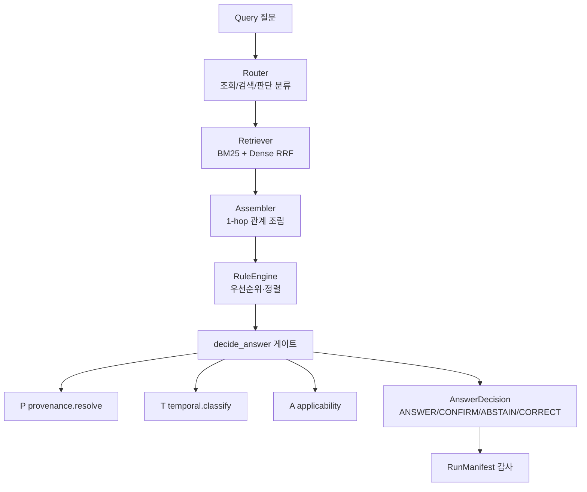

# ARCHITECTURE — 계층 구조와 데이터 계약

TAP-LegalRAG는 각 단계를 **교체 가능한 부품**으로 나누고, 단계 사이는 `models`의 타입(데이터 계약)으로만 소통한다. 그래서 검색기 하나를 바꿔도 게이트는 안 깨지고, 게이트 한 축(P/T/A)을 꺼도 나머지는 돈다 — 절제 실험이 코드로 실행된다.

## 전체 흐름

모든 소비자(평가 `eval_decision.py`·시연 `build_demo.py`·CLI `python -m law_rag ask`)는 **단일 경로** `law_rag.decide.decide_for_query`를 통과한다. "평가한 경로"와 "실제 쓰는 경로"가 다르면 측정이 무의미해지므로 하나로 통일했다.

## 계층

| 계층 | 모듈 | 하는 일 |
|---|---|---|
| 데이터 계약 | `models/` | `LawChunk·Edge·Query·EvidenceBundle·LegalRef·AnswerDecision`. 필드 삭제·개명은 사용자 확인 후. |
| 라우터 | `router/` | 질문 유형(lookup/search/judgment) + 주제 태깅. 규칙 기반(LLM 아님). |
| 검색 | `retrieval/` | `BM25Searcher`(Okapi, k1=1.5·b=0.75) + Dense 참조구현 → RRF. `retrieve_with_signal`이 관련도 신호도 반환. |
| 지식 | `knowledge/` | `parser`(XML→청크, 관계 추출) · `loader`(코퍼스·엣지·매니페스트) · `Assembler`(1-hop 조립). |
| 추론 | `reasoning/` | `RuleEngine` + 플러그인 규칙(우선순위·시점·안정성). 켜고 끌 수 있다. |
| **게이트** | `gate.py` | `decide_answer`. P·T는 **질문 속 인용에만** 적용(검색된 현행 조문엔 미적용 — rc2 수정). |
| P | `provenance.py` | `resolve(mode=naive/fallback/pgate)` → `LegalRef`(4 상태). 괄호 제목은 인용에서 제외. |
| T | `temporal.py` | `classify`. 조 단위 존재 확인 후, 낡은 번호가 현행에도 있으면 단정 금지(AMBIGUOUS_HISTORIC·후보 제시). |
| 통제 | `governance/` | Governor(생성→인용→확신도→감사), `confidence.py`. |
| 결정 경로 | `decide.py` | 위 전부를 묶는 단일 진입점. CLI·평가·시연 공유. |

## 핵심 설계 결정

1. **게이트의 P·T는 '질문 속 인용'에만.** 초기판(rc1)은 검색된 근거 전체에 P·T를 적용해 멀쩡한 현행 조문을 흔들었다. rc2에서 `_question_citation(query.text)`로 한정.
2. **낡은 번호를 단정 교정하지 않는다.** '제64조 제2항'은 밀린 번호이기도 하고 현행에도 있다. 번호만으로 교정(CORRECT)하면 위험 → **후보 2개 + CONFIRM**(rc3).
3. **B0 기준선 = 실제 BM25.** 단순 토큰 겹침은 약한 기준선이라 이후 단계 효과를 부풀린다. 공정 비교를 위해 Okapi BM25로 고정.
4. **무거운 의존성 없음.** 임베딩·리랭커·벡터DB·그래프DB는 골든셋 동결 전까지 도입하지 않는다. 재현이 `pip install pydantic pytest`로 끝난다.

## 데이터 계약 불변식 (요약)

- `body_text`(조문 원문)는 절대 가공하지 않는다. 검색용 문맥은 별도 필드.
- `chunk_id` = `LAW-{law_id}-J{조}[-H{항}]`, 별표 `-B{n}`, 분할 자식 `-S{n}`.
- 관계 타입 `EdgeType` 5종 고정(delegates_to·refers_to·exception_to·amends·requires). 코퍼스 밖 참조는 `EXT:「법령명」 제N조` 문자열.
