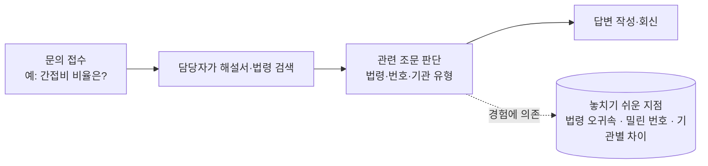
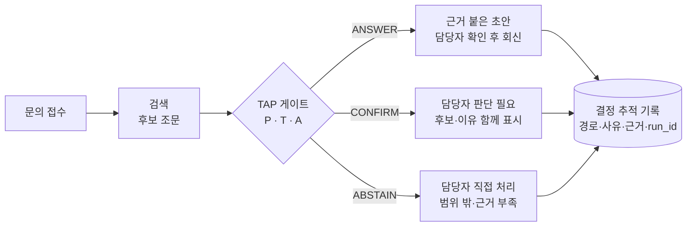
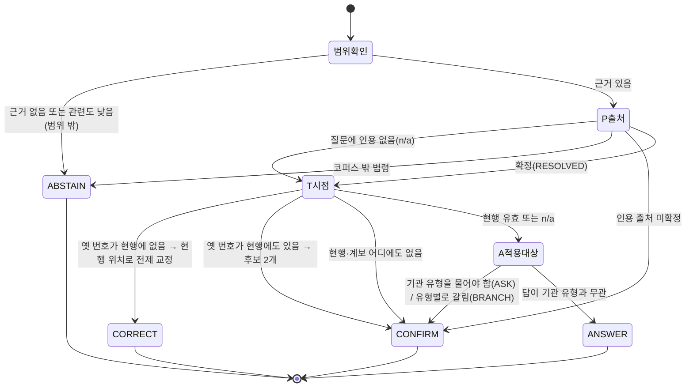

# WORKFLOW — 업무 흐름과 판정 상태 전이

> ⚠️ **이 문서의 업무 흐름(As-is / To-be)은 설계 가정입니다.** 현장 사용자 조사나 사용성 평가 결과가 아닙니다.
> 상태 전이도와 실패 사례는 실제 코드(`src/law_rag/gate.py`)와 실행 결과를 기준으로 작성했습니다.

---

## 1. 업무 흐름 — 지금과 바꾸려는 모습

### As-is (가정): 담당자가 직접 찾아서 답한다



검색 시간도 문제지만, 더 큰 위험은 **판단 단계가 사람의 경험에만 기대고 기록이 남지 않는 것**이라고 가정했습니다.

### To-be (설계): 게이트가 먼저 "답해도 되는지"를 표시하고, 사람은 걸린 것만 본다



**사람이 개입하는 지점**

| 지점 | 사람이 하는 일 | 시스템이 주는 것 |
|---|---|---|
| ANSWER 초안 확인 | 근거 조문이 질문에 맞는지 최종 확인 | 근거 조문, 판정 경로 |
| CONFIRM | 후보 중 맞는 것 선택, 또는 질문자에게 기관 유형 확인 | 후보 2개(시점) 또는 기관 유형별 분기(적용대상), 이유 |
| ABSTAIN | 직접 조사하거나 소관 기관에 문의 | 보류 사유(외부 법령, 범위 밖 등) |

> 이 흐름에서 **실제로 구현된 것은 게이트 판정과 추적 기록까지**입니다. 담당자 검토 화면, 회신 연계, 권한 관리는 구현하지 않았습니다.

---

## 2. 판정 상태 전이 — 코드가 실제로 따르는 순서

게이트는 아래 순서대로 검사하고, **처음 걸리는 곳에서 멈춥니다.** P·T는 질문에 조문 인용이 있을 때만 적용됩니다.



| 단계 | 상태값 | 결정 |
|---|---|---|
| 범위 확인 | 근거 없음 / 관련도 0.15 미만 | ABSTAIN |
| P 출처 | external(코퍼스 밖) | ABSTAIN |
| | PARTIAL · AMBIGUOUS · UNRESOLVED | CONFIRM |
| | RESOLVED / n/a | 다음 단계 |
| T 시점 | HISTORIC_VALID(옛 번호, 현행엔 없음) | CORRECT |
| | AMBIGUOUS_HISTORIC(옛 번호이면서 현행에도 있음) | CONFIRM |
| | DRIFT_UNRESOLVED(어디에도 없음) | CONFIRM |
| | CURRENT_VALID / n/a | 다음 단계 |
| A 적용대상 | ASK · BRANCH | CONFIRM |
| | NONE | ANSWER |

평가에서는 ASK·BRANCH를 CONFIRM 한 클래스로 묶습니다([EVAL_SPEC](../specs/EVAL_SPEC_v1.md)).

---

## 3. 대표 실패 사례 3가지 — 무엇이, 왜 틀렸나

### 사례 1. 사전 누락 — 답할 수 있는데 보류

```text
[CONFIRM] 연구개발비 사용 기준 제45조는 어떤 기관에 적용되나요?
  사유: 질문 인용 출처 미확정
  경로: P=unresolved
```

- **무엇이 틀렸나:** 사람은 「국가연구개발사업 연구개발비 사용 기준」(고시)이라는 것을 바로 압니다. 그러나 해석기의 법령 이름 사전은 낫표(「」) 없이 쓴 이 고시 이름을 인식하지 못해 출처를 확정하지 못했습니다.
- **규모:** 조문 인용 평가에서 pgate의 잘못된 보류 중 **10건**이 같은 원인이며, 사람은 10건 모두 올바른 법령을 판단했습니다.
- **처방(v1.1):** 괄호 없는 고시·외부 법령 이름 인식 추가. 규칙 한 곳의 결함이라 수정 범위가 좁습니다.

### 사례 2. 법령 이름 없는 인용을 확정 — 근거 없는 확정

- **무엇이 틀렸나:** 문맥 기준 평가(test 60)에서 pgate가 "답할 수 없는 문항"을 확정한 7건 중 4건은 "시행령 제9조"처럼 **어느 법의 시행령인지 쓰지 않은 인용**이나 "법", "동법"을 혁신법 계열로 확정한 경우였습니다. 1건은 다른 법률의 시행규칙을 혁신법 시행규칙으로 붙였습니다.
- **왜:** 해석기가 "시행령"·"시행규칙" 같은 일반 명칭을 이 프로토타입의 코퍼스 법령으로 우선 해석하도록 되어 있기 때문입니다.
- **처방(v1.1):** 일반 명칭만 있는 인용은 앞 문장에 법령 이름이 명확할 때만 확정하고, 그 밖에는 확인 요청으로 낮춥니다. 이렇게 고치면 잘못된 보류가 늘 수 있어, 바꾼 뒤 세 기준 모두로 다시 측정합니다.

### 사례 3. 검색 순위가 낮음 — 판정 이전의 한계

- **무엇이 틀렸나:** 자연어 질문에서 정답 조문이 상위 5개 안에 드는 비율(R@5)이 0.372입니다. 게이트가 아무리 정확해도, 근거 후보에 정답 조문이 없으면 좋은 답을 만들 수 없습니다.
- **왜:** 의미 기반 검색(임베딩)과 재정렬을 일부러 넣지 않았습니다(재현성·의존성 최소화, [DESIGN_DECISIONS D7](DESIGN_DECISIONS.md)).
- **처방(v1.2):** 외부 조문 조회 도구와 역할을 나눠, 명시 인용은 조문 직접 조회로 보완합니다. 이때 검색 개선 효과와 게이트 효과를 같은 질문·같은 지표로 따로 측정합니다.
